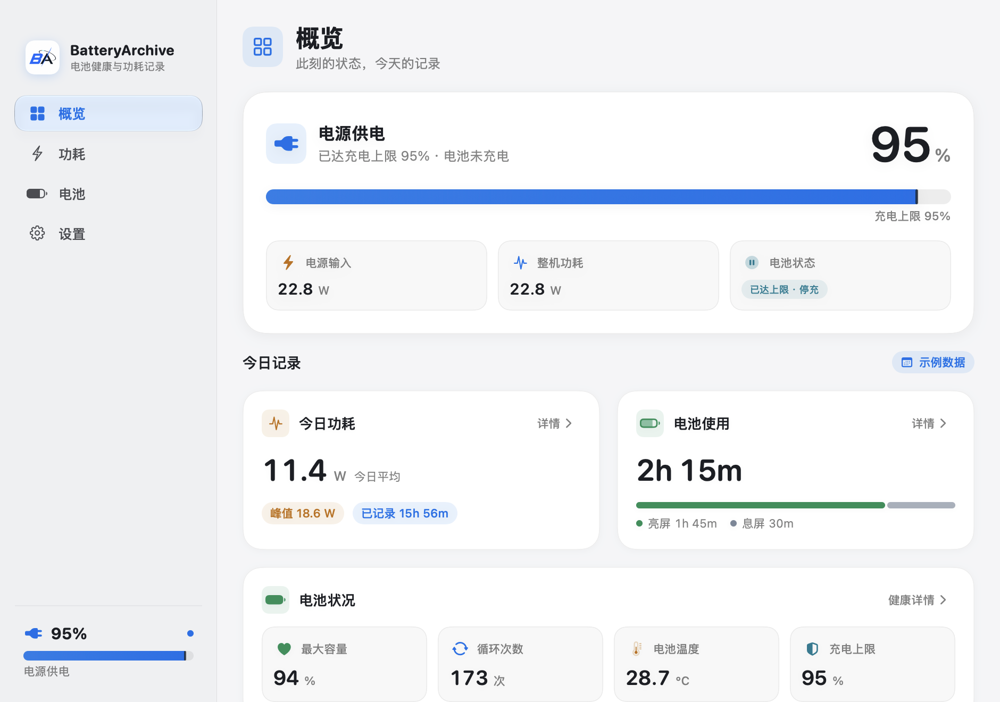
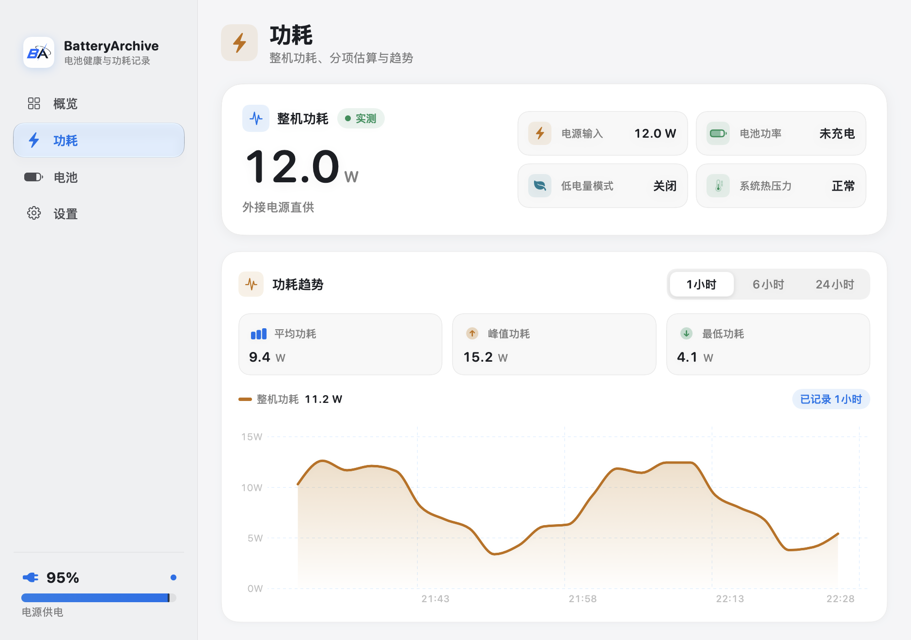

<div align="center">


<h1>BatteryArchive</h1>

<p>
  <strong>原生 macOS 菜单栏电池健康、离电使用与整机功耗记录工具 — 100% 纯本机存储，零遥测。</strong><br />
  <sub>Native macOS menu-bar battery health, usage &amp; power monitor — 100% local, zero telemetry.</sub>
</p>

<p>
  
  
  <a href="LICENSE"></a>
  
</p>

<p>
  <a href="#功能特性">功能特性</a> ·
  <a href="#界面预览">界面预览</a> ·
  <a href="#下载与安装">下载 DMG</a> ·
  <a href="#源码构建">源码构建</a> ·
  <a href="#隐私与特权-helper-安全说明">隐私与安全</a>
</p>

</div>

---

**BatteryArchive** 使用纯 Swift 6.2、SwiftUI、AppKit 与 Swift Charts 构建，零第三方依赖，专为 macOS 14.0+ 打造。它帮助你用清晰、克制、无术语负担的原生界面掌握此刻供电状态、今日整机功耗、离电亮屏/息屏使用以及按天永久沉淀的电池健康度曲线。

## 功能特性

- **菜单栏实时百分比与原生弹窗**：状态栏紧贴系统图标显示实时电量（低电量自动变红）；点击展开轻量原生弹窗，一眼掌握供电状态、电池健康徽章、充电上限感知的剩余时间估算以及整机功耗、电池/输入功率、电池温度与今日离电。
- **充电上限感知的充满预计时间**：完整适配无上限（100%）以及 macOS `80% / 85% / 90% / 95% / 100%` 系统充电上限，结合恒流与 80% 以上恒压涓流阶段估算达到目标电量所需时间；离电时同步提供可信剩余续航预估。
- **四栏原生 macOS 主窗口**：
  - **概览**：实时供电状态、电源输入与整机功耗、今日功耗（今日平均 / 峰值与已记录时长）、今日离电使用和四栏电池状况。
  - **功耗**：实时整机功耗、可选 CPU / GPU / 内存分项功耗、24 小时功耗趋势（平均 / 峰值 / 最低全瓦特指标）与电池温度趋势及折叠电源诊断。
  - **电池**：分「使用 / 健康」两页——「使用」提供每日离电亮屏 / 息屏时长、平均离电功耗、电量与电源时间轴及主要离电时段；「健康」展示系统报告最大容量、**永久本机保存的电池健康度趋势**（最大容量阶梯曲线、满充容量比参考线、满充容量 mAh 含设计容量基准线与循环次数）、电池标称容量与设计循环上限。
  - **设置**：精简三张卡片——常规与提醒（开机自启、低电量与充电目标通知）、高级采样（内嵌辅助服务状态与一键移除）、本机数据（健康记录天数 / 使用明细 30 天 / 功耗趋势 24 小时及折叠诊断）。
- **100% 纯本机存储，零网络上报**：所有记录仅保存在本机，不接入任何云端同步或统计分析。电池健康度趋势（`battery-health-history.jsonl`）与每日汇总永久保存，五分钟使用明细保留 30 天，每分钟功耗快照保留 24 小时。

## 界面预览

| 概览 | 功耗 |
| :---: | :---: |
|  |  |

| 电池健康与趋势 | 菜单栏弹窗 |
| :---: | :---: |
|  |  |

## 系统要求

- **macOS 14.0 (Sonoma)** 及以上（Apple Silicon / Intel 均可）
- **Xcode / Swift 6.2+**（仅本地源码构建需要）
- **零第三方依赖**

## 下载与安装

### 下载正式安装包（推荐）

1. 前往 [GitHub Releases](../../releases/latest) 下载 **`BatteryArchive-v1.0.0.dmg`**（附带 `SHA256SUMS.txt` 校验文件）。
2. 双击打开 DMG 镜像，将 **BatteryArchive**（`BatteryBar.app`）拖入 `Applications` 文件夹即可启动。
3. 可选校验下载完整性：
   ```bash
   shasum -a 256 -c SHA256SUMS.txt
   ```

<details>
<summary><strong>首次打开遇到 macOS Gatekeeper 提示怎么办？</strong></summary>

开源版本采用本地 ad-hoc 签名（未经过 Apple 公证），首次从网络下载打开时 macOS 可能会拦截提示。可通过以下任一方式放行：

- **方式 A（终端移除隔离属性）**：
  ```bash
  xattr -dr com.apple.quarantine /Applications/BatteryBar.app
  ```
- **方式 B（系统设置放行）**：
  尝试打开一次后，前往 **系统设置 → 隐私与安全性** 底部，点击 **仍要打开** 即可。

</details>

## 源码构建

```bash
# 运行全部单元测试
swift test

# 编译并生成严格签名的 Release App（含内嵌 Helper）
bash scripts/build-app.sh

# 生成安装包 BatteryArchive.dmg（自动执行 hdiutil verify 并打印 SHA-256）
bash scripts/build-dmg.sh

# 本机安全安装 / 更新到 ~/Applications 并自动启动（先构建验签，再优雅退出替换，失败自动回滚）
bash scripts/update.sh
```

> 默认安装目录为 `~/Applications`，可通过环境变量自定义，例如 `BATTERYBAR_INSTALL_DIR=/Applications bash scripts/update.sh`。

## 隐私与特权 Helper 安全说明

- **默认零特权运行**：基础电量、整机功耗、离电使用、温度与电池健康度趋势全部基于标准 `IOKit` / 系统接口读取，**无需管理员密码、不安装后台服务**。
- **按需启用、空闲退出**：仅当你手动开启「功耗」页或「设置 → 高级采样」开关以查看 CPU / GPU / 内存分项功耗时，才会请求一次管理员授权安装按需启动的 XPC Helper（`/Library/PrivilegedHelperTools/com.batterybar.helper`），空闲后自动退出，不常驻后台。
- **签名与 CDHash 绑定**：安装器与 `scripts/install-helper.sh` 对 Helper 二进制执行 SHA-256 与 `codesign --verify --strict` 校验，并将已签名主应用的 CDHash 写入 `LaunchDaemon` 授权配置，仅接受匹配的客户端连接。
- **随时一键移除**：关闭「高级采样」立即停止调用；如需彻底卸载后台服务与配置，可直接在 **设置 → 高级采样** 点击 **移除辅助服务…**。

## 项目结构

```text
├── Package.swift                  # Swift 6.2 SwiftPM 清单
├── Sources/
│   ├── BatteryBar/
│   │   ├── App/                   # 应用入口、菜单栏生命周期、关于面板与窗口策略
│   │   ├── Calc/                  # 续航与充电估算、趋势抽稀、统计分析
│   │   ├── Data/                  # IOKit 读取、采样调度、本机持久化、通知与 Helper 管理
│   │   ├── MenuBar/               # 菜单栏弹窗（StatusPopover）
│   │   ├── Models/                # 电池信息、健康历史、充电策略与状态模型
│   │   ├── Resources/             # 应用图标资源
│   │   └── Views/                 # 主窗口四栏视图、健康度趋势图与设计系统
│   ├── TelemetryCore/             # 主应用与 Helper 共用的分项遥测解析与授权校验
│   └── BatteryBarHelper/          # 可选按需特权分项采样 Helper
├── Tests/BatteryBarTests/         # Swift Testing 单元测试与视觉布局 QA
├── scripts/
│   ├── build-app.sh               # Release 编译、打包与严格签名校验
│   ├── build-dmg.sh               # 生成并校验 BatteryArchive.dmg（支持自定义输出文件名）
│   ├── update.sh                  # 构建优先、失败自动回滚的本机安全更新脚本
│   └── install-helper.sh          # 开发者手动安装按需 Helper 脚本
├── docs/screenshots/              # README 展示截图
└── .github/workflows/
    ├── build.yml                  # CI 构建、安全边界检查与单元测试
    └── release.yml                # Tag 触发自动构建、校验并发布 DMG 到 GitHub Releases
```

## 开源协议

本项目基于 [MIT License](LICENSE) 开源。
