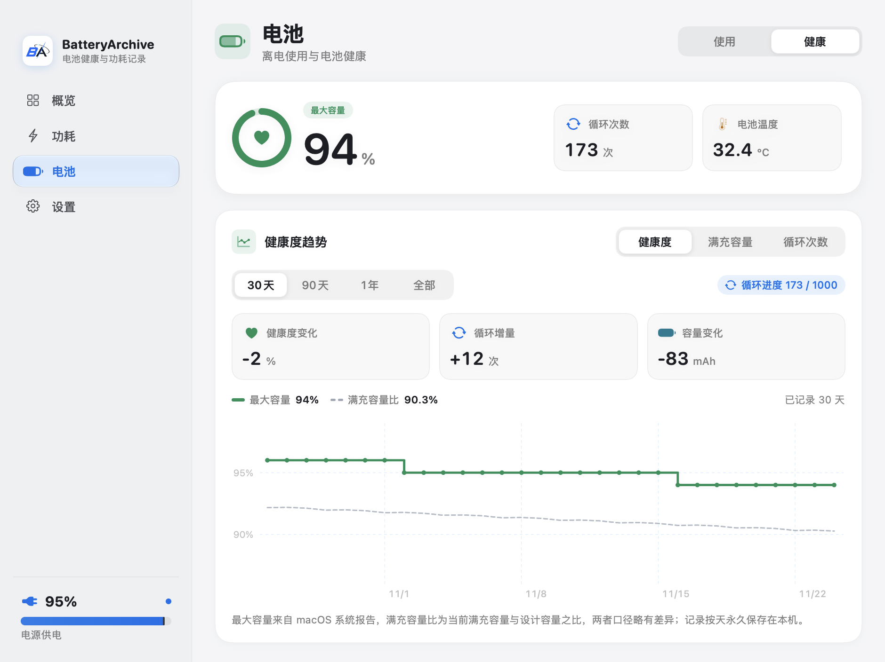
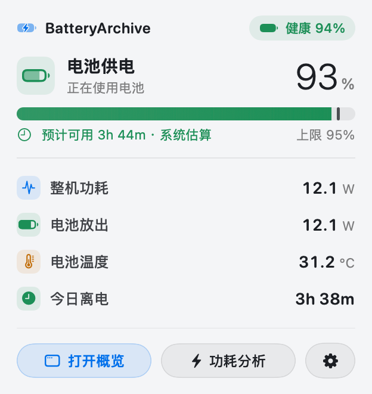

<div align="center">


<h1>BatteryArchive</h1>

<p>
  <strong>原生 macOS 菜单栏电池健康、离电使用与功耗记录工具</strong><br />
  <sub>Native macOS menu-bar battery health, usage &amp; power monitor — 100% local, zero dependencies.</sub>
</p>

<p>
  
  
  <a href="LICENSE"></a>
</p>

<p>
  <a href="../../releases/latest"><strong>下载 DMG</strong></a> ·
  <a href="#界面预览">界面预览</a> ·
  <a href="#功能">功能</a> ·
  <a href="#安装">安装</a> ·
  <a href="#源码构建">源码构建</a>
</p>

</div>

---

## 界面预览

| 概览 | 功耗 |
| :---: | :---: |
|  |  |

| 电池健康趋势 | 菜单栏弹窗 |
| :---: | :---: |
|  |  |

## 功能

- **菜单栏实时状态**：状态栏显示电量百分比（低电量自动变红），点击弹窗即可查看供电状态、整机功耗、电池温度、今日离电与电池健康。
- **剩余时间估算**：离电时估算剩余续航；充电时自动适配无上限（100%）与 `80% / 85% / 90% / 95% / 100%` 系统充电上限，预估充满或到达上限的剩余时间。
- **功耗分析**：实时监控整机功耗与 24 小时功耗/温度趋势；可选开启高级采样查看 CPU / GPU / 内存分项功耗。
- **离电使用与健康趋势**：记录每日亮屏/息屏离电时长与主要离电时段；按天**永久保存**电池最大容量、满充容量与循环次数变化曲线。
- **纯本机存储**：不联网、无统计上报，全部数据保存在本机（健康记录与日汇总永久保留，使用明细保留 30 天，功耗快照保留 24 小时）。
- **实用提醒**：支持低电量提醒、充满/到达上限通知与开机自启。

## 安装

需要 **macOS 14.0 (Sonoma)** 及以上版本。

1. 前往 [Releases](../../releases/latest) 下载最新的 `BatteryArchive-*.dmg`。
2. 打开镜像，将 **BatteryArchive** 拖入 `Applications` 文件夹即可使用。

<details>
<summary>首次打开提示「无法验证开发者」怎么办？</summary>

开源版本采用本地签名（未经过 Apple 公证），首次从网络下载打开可能会触发 macOS Gatekeeper 拦截，任选其一即可放行：

- 在终端执行：
  ```bash
  xattr -dr com.apple.quarantine /Applications/BatteryBar.app
  ```
- 或先尝试打开一次，再前往 **系统设置 → 隐私与安全性** 底部点击 **仍要打开**。

</details>

## 权限说明

- **默认零特权**：所有基础电量、功耗、温度、使用时长与健康趋势功能均无需管理员权限，也不安装后台服务。
- **分项功耗按需授权**：仅当你手动开启「高级采样」以查看 CPU / GPU / 内存分项功耗时，才会请求一次管理员权限安装按需后台服务；空闲自动退出，可在 **设置 → 高级采样** 中随时一键移除。

## 源码构建

需要 Xcode（Swift 6.2+），无第三方依赖：

```bash
swift test                    # 运行单元测试
bash scripts/build-app.sh     # 编译并签名 Release App
bash scripts/build-dmg.sh     # 打包 DMG 安装镜像
bash scripts/update.sh        # 编译验签并安全安装到 ~/Applications
```

## 开源协议

[MIT License](LICENSE)
