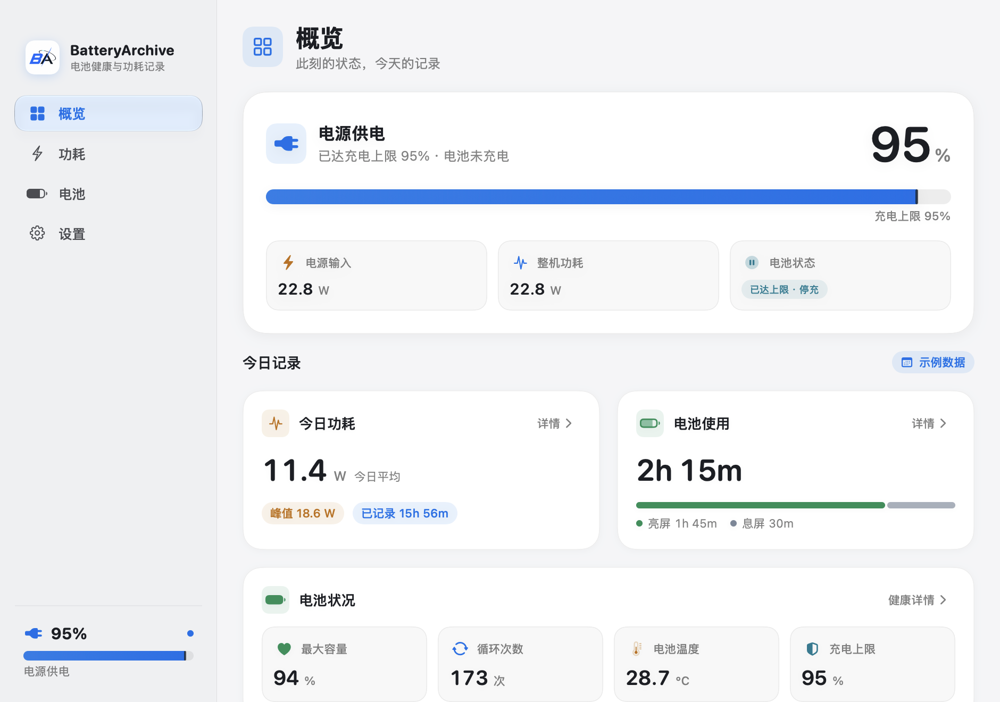
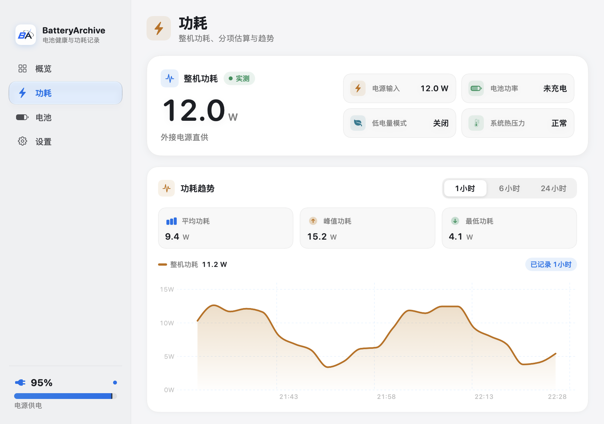
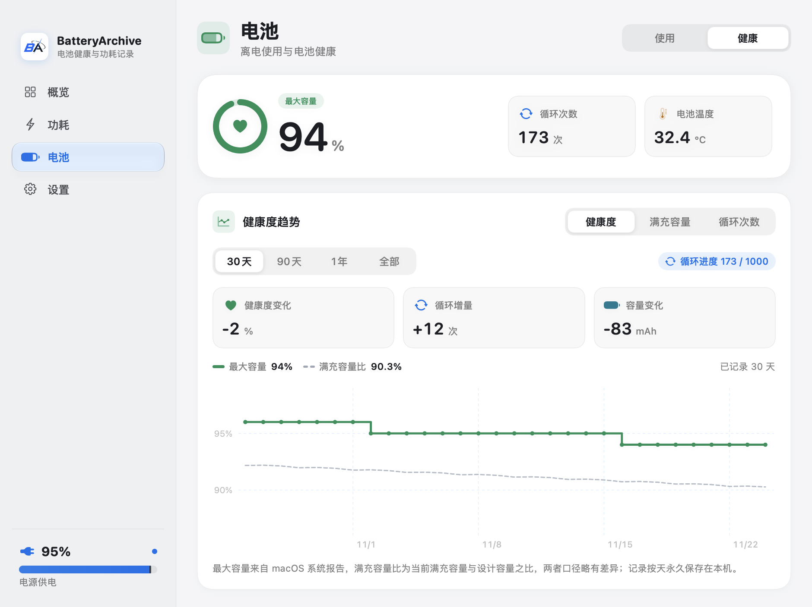
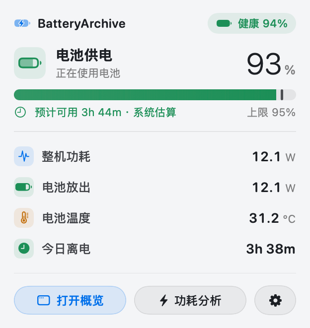

<div align="center">


<h1>BatteryArchive</h1>

<p>
  <strong>Native macOS menu-bar battery health, usage &amp; power monitor</strong><br />
  <sub>100% local storage, zero telemetry, zero third-party dependencies.</sub>
</p>

<p>
  
  
  <a href="LICENSE"></a>
</p>

<p>
  <a href="README.md">简体中文</a> · <strong>English</strong>
</p>

<p>
  <a href="../../releases/latest"><strong>Download DMG</strong></a> ·
  <a href="#screenshots">Screenshots</a> ·
  <a href="#features">Features</a> ·
  <a href="#installation">Installation</a> ·
  <a href="#building-from-source">Build</a>
</p>

</div>

---

## Screenshots

| Overview | Power |
| :---: | :---: |
|  |  |

| Battery Health Trend | Menu Bar Popover |
| :---: | :---: |
|  |  |

## Features

- **Menu Bar & Popover**: Compact battery percentage in the menu bar (turns red on low battery) with a native popover showing power state, system wattage, battery temperature, today's battery usage, and battery health.
- **Limit-Aware Time Estimates**: Estimates remaining runtime on battery, and time to full or configured macOS charge limit (`80% / 85% / 90% / 95% / 100%` or no limit) while charging.
- **Power Analysis**: Live system wattage plus 24-hour power and temperature trends; optional on-demand CPU / GPU / DRAM component breakdown.
- **Battery Usage & Health Trend**: Tracks daily screen-on/screen-off battery time and major discharge sessions; permanently archives daily maximum capacity, full-charge capacity, and cycle count curves locally.
- **100% Local & Private**: No network requests and no analytics. Health history and daily summaries are stored permanently on your Mac (5-minute usage details for 30 days, 1-minute power snapshots for 24 hours).
- **Notifications & Launch at Login**: Low-battery alerts, charge-target notifications, and launch at login.

## Installation

Requires **macOS 14.0 (Sonoma)** or later.

1. Download the latest `BatteryArchive-*.dmg` from [Releases](../../releases/latest).
2. Open the DMG and drag **BatteryArchive** into your `Applications` folder.

<details>
<summary>macOS Gatekeeper warning on first launch?</summary>

Because open-source builds are ad-hoc signed (not Apple notarized), macOS may warn when opening the app for the first time. Either option resolves it:

- Run in Terminal:
  ```bash
  xattr -dr com.apple.quarantine /Applications/BatteryBar.app
  ```
- Or open the app once, then click **Open Anyway** at the bottom of **System Settings → Privacy & Security**.

</details>

## Permissions

- **Zero privileges by default**: Battery level, wattage, temperature, usage history, and health trends all use standard macOS `IOKit` APIs — no administrator password and no background daemon required.
- **Optional component power**: Only when you explicitly enable **Advanced Sampling** for CPU / GPU / DRAM power does the app prompt once to install an on-demand helper tool. It exits automatically when idle and can be removed in one click under **Settings → Advanced Sampling**.

## Building from Source

Requires Xcode (Swift 6.2+), with zero third-party dependencies:

```bash
swift test                    # Run unit tests
bash scripts/build-app.sh     # Build and sign the Release app
bash scripts/build-dmg.sh     # Create a verified DMG installer
bash scripts/update.sh        # Build, verify, and safely install to ~/Applications
```

## License

[MIT License](LICENSE)
